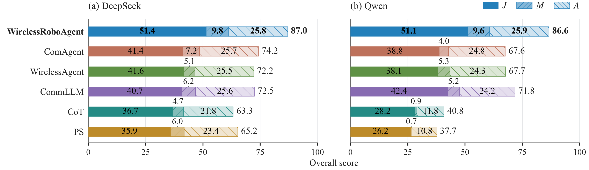
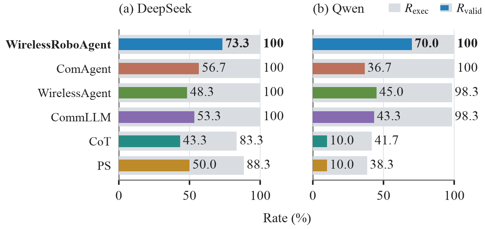
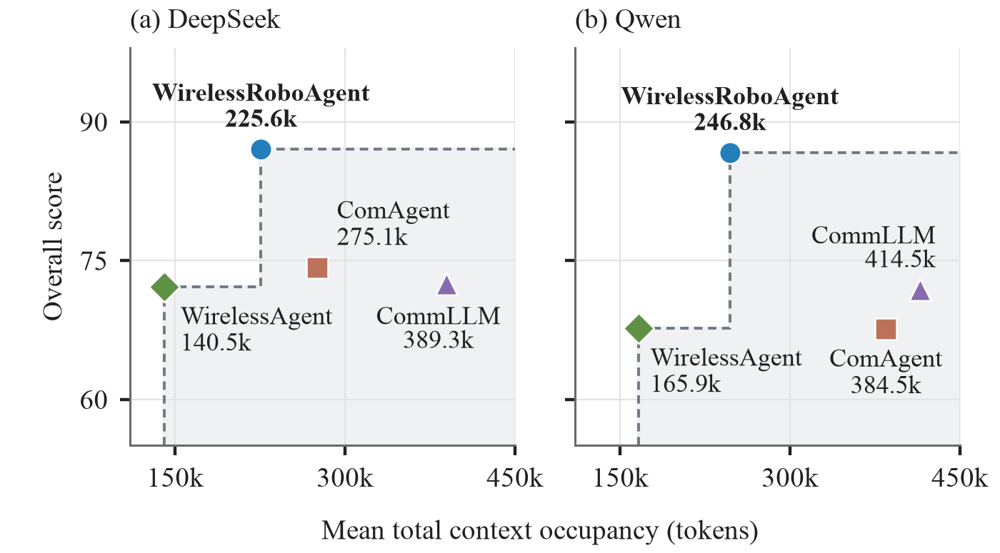

<h1 align="center">WirelessRoboAgent</h1>

<h2 align="center">Agentic AI and Benchmarking for Intelligent Wireless Robotics</h2>

<p align="center">
  <a href="https://github.com/ygyang11/WirelessRoboAgent/actions/workflows/ci.yml"></a>
  <a href="LICENSE"></a>
</p>

<p align="center">
  <a href="#framework">Framework</a> ·
  <a href="#benchmark">Benchmark</a> ·
  <a href="#results">Results</a> ·
  <a href="#getting-started">Getting Started</a> ·
  <a href="#citation">Citation</a>
</p>

WirelessRoboAgent is a unified agent framework for diverse wireless robotics tasks. WirelessRoboBench is an agent benchmark with execution-grounded
multidimensional evaluation across 60 open-ended tasks spanning six families.

## Framework

WirelessRoboAgent integrates unified reasoning and adaptive refinement,
task-adaptive capability augmentation, and long-horizon autonomy.

[](assets/framework.png)

## Benchmark

WirelessRoboBench comprises 60 open-ended tasks across six families, developed
through domain-grounded construction for execution-grounded multidimensional
agent evaluation.
[Browse the 60 tasks](https://github.com/ygyang11/Arktor-Bench-SelfEvolution/tree/research/wireless-robo-agent/packs/wireless_robot).

[](assets/benchmark.png)

## Results

Experiments with two LLM backbones and five baselines show improvements of
**17.2%–20.6%** in overall scores and **16.7–25.0 percentage points** in valid execution
rates over the strongest respective baselines.

[](assets/overall.png)

*Comparison of overall scores, with mean weighted contributions from execution
and feasibility assessment (A), validity-gated performance (M), and rubric-based
quality assessment (J).*

<table>
  <tr>
    <td width="50%" align="center">
      <a href="assets/reliability.png"></a>
    </td>
    <td width="50%" align="center">
      <a href="assets/efficiency.png"></a>
    </td>
  </tr>
  <tr>
    <td align="center"><em>Comparison of execution success rates and valid execution rates.</em></td>
    <td align="center"><em>Overall score versus mean total context occupancy.</em></td>
  </tr>
</table>

## Getting Started

### Installation

Clone the repository with its submodules, then create and activate the shared
Conda environment:

```bash
git clone --recurse-submodules \
  https://github.com/ygyang11/WirelessRoboAgent.git
cd WirelessRoboAgent
conda env create -f environment.yaml
conda activate arktor-com
```

### Usage

Explore the framework and benchmark through their detailed component pages:

| Component | Contents |
| --- | --- |
| [WirelessRoboAgent](wirelessroboagent/) | Agent framework and usage. |
| [WirelessRoboBench](wirelessrobobench/) | Task pack and evaluation. |

## Citation

```bibtex
BibTeX citation will be added when the paper is publicly available.
```

## License

Released under the [MIT License](LICENSE).
